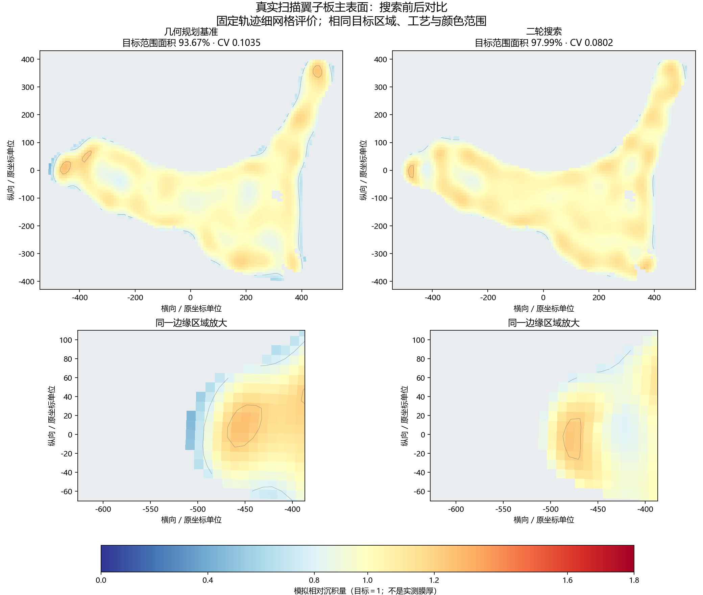
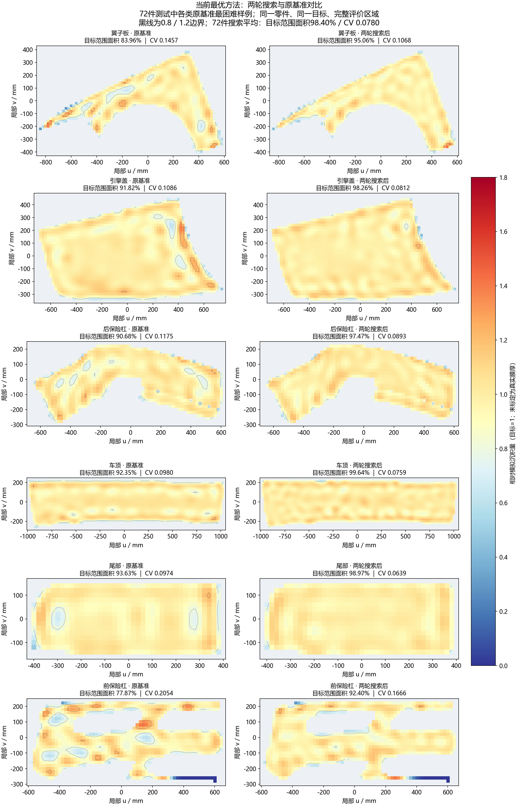
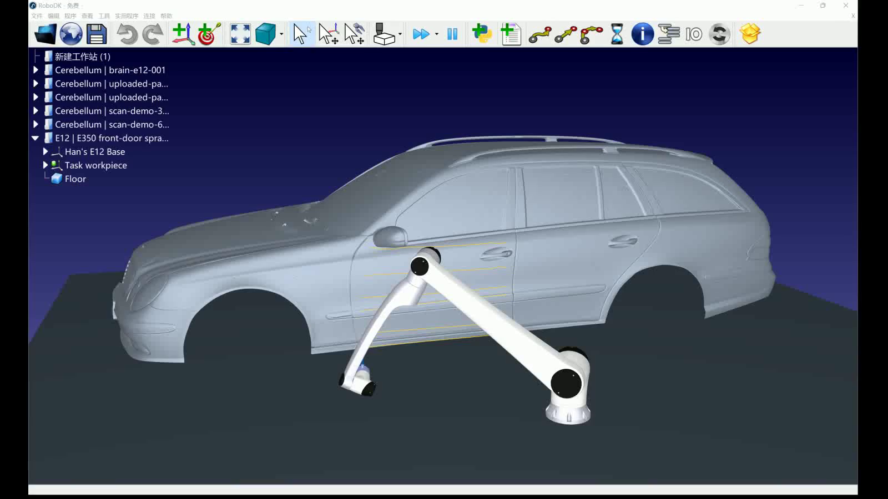

# 汽车喷涂机器人小脑

本项目面向汽车车身喷漆。大脑负责喷漆skill蒸馏和任务下发；小脑接收结构化指令，生成车身曲面的末端轨迹，完成华沿E12运动检查、RoboDK仿真和结果回传。

软件版本0.3.1，HTTP/JSON协议保持v1。[接入入口](docs/START_HERE.md) · [最新真实扫描实验](docs/EXPERIMENT_20261116.md) · [演示复现](docs/PRECISE_DEMO.md)

## 最新进展：真实扫描异形件

[11.16组会汇报：点云重建与搜索测试](docs/EXPERIMENT_20261116.md)

在一个实际扫描翼子板状工件的主表面完成二轮搜索测试：固定轨迹细网格复核中，目标±20%范围面积从93.67%提升至97.99%，CV从0.1035降至0.0802，边缘目标范围面积从90.03%提升至96.73%；搜索用时14.8秒，开喷时长增加约4.5%。这是未标定的相对沉积结果，折回边和背面未做喷涂评价。11月10日已在服务器RoboDK 6.0.6教育版中完成E12的471点逆解、关节范围、路径碰撞检查及完整原生仿真；仅修正1处关喷转移。验证使用假定比例和虚拟工件摆放，不代表实机验收。

新增1—8轮搜索对比：72件汽车零件上，目标范围面积从二轮98.40%提高至四轮98.71%、八轮98.82%，CV从0.0780降至0.0729、0.0703；平均搜索耗时分别为27.4、46.6、76.9秒。另完成54个合成异形件和1个真实扫描件验证。四轮适合兼顾耗时与质量，八轮适合优先追求均匀度；新增路径尚未完成E12运动与碰撞验证。[完整表格与热力图](experiments/search_sweeps_20261110/README.md)。

14份点云文件中11份可读，属于同一工件的重复扫描，不是11个独立样本。原坐标暂按毫米1:1用于数值试验，实际单位待确认。另有18类54个合成曲面的适应性测试，和真实扫描结果分开统计。当前仍不是任意新工件的全自动处理流水线。



离线复核：`python tools/verify_real_scan_search.py`。原始企业点云未上传；完整整车演示及既有接口继续按下文说明使用。

## 汽车零部件方法对比（11.9）

[11.9组会汇报：方法对比、训练配置与效果图](docs/EXPERIMENT_20261109.md)

完成六类汽车零件数据准备，依次训练并保存三个阶段的模型：**SAC → SAC＋模仿学习 → SAC＋模仿学习＋SAC微调**。先用12,388个训练零件训练SAC，再让其动作网络学习搜索示范，最后以上一步模型为起点进行SAC微调。在同一72件测试集上，当前质量最好的是两轮搜索：目标±20%范围面积98.40%、CV 0.0780、边缘范围面积96.90%；学习模型中，第二阶段“SAC＋模仿学习”最好：95.52%、CV 0.0912，第三阶段的SAC微调没有额外提升。



指标来自未实测标定的相对沉积模型；这72件已用于方法比较。最新实验与下方整车演示分别保留，本次结果同步没有替换演示权重或接口实现。

## 汽车演示：完整车身视野

[观看39秒汽车喷漆演示](docs/media/E12_E350_WholeCar_View.mp4)



视频时长39.1秒，展示E350车身、E12机械臂、TCP轨迹及前车门约0.58m²区域的喷涂过程。训练与定量评价见实验记录。

车身采用Artec 3D扫描重建网格，车长约4.88m，包含106万个顶点、211万个三角面。完整网格用于显示和碰撞，5mm派生曲面用于规划。车门轮廓和把手遮罩人工指定。

## 运行当前汽车模型

使用已有Python3.11/3.12环境；无需重训，也不需要GPU推理。

```bash
python -m pip install -e ".[test,geometry,rl,robodk,demo]"
python tools/setup_automotive_demo.py
python tools/fetch_robot.py
python tools/replay_demo.py --asset-id sacgen_e350_v2
```

Windows可双击`Run_Precise_Demo.bat`，`Show_Demo.bat`只切回已完成的汽车场景。通过`ROBODK_EXE`和`ROBODK_PORT`设置实际安装路径及端口。更新代码后，使用者需重启API服务以加载新版代码。

以下整车演示采用的SAC经过24万步、67分钟通用曲面预训练，采用验证集选中的18万步检查点。汽车数值对照在同一E350前车门比较固定蛇形路线400mm/s、同路线最高约500mm/s、SAC横向±10mm及速度300～500mm/s调整。三者分别在3个给定沉积倍率下计算，共9次；这是已知系数敏感性检查，跨车型泛化尚未验证。完整结果、适用范围和模型卡见[汽车实验记录](docs/EXPERIMENT_20261029.md)及[model_card.json](demo/e350_sac_v2/model_card.json)。

```bash
# CPU核对当前汽车实验的全部平均指标，不调用RoboDK
python tools/evaluate_automotive.py --verify-recorded
```

159段路径通过E12按5mm/1°采样的可达性、运动和碰撞检查，并完成仿真播放。名义工况下SAC未优于固定高速参考；相对覆盖与热力图不代表实测膜厚。

## 大小脑接口

只做消息联调时：

```bash
python -m pip install -e ".[test]"
python -m spray_cerebellum
# 另开终端：
python examples/brain_client.py --task examples/task_mock.json
```

服务`http://127.0.0.1:8765`，交互文档`/docs`。大脑流程：任务JSON → POST `/v1/tasks` → 轮询状态 → 获取轨迹和结果。mock不代表已经通过机器人运动检查。

实际汽车仿真使用`examples/task_precise_door.json`。输入工件ID、UV区域、4×4刚体变换，以及喷距、名义速度、喷幅、搭接率、遍数；输出TCP位姿/速度/开关、E12关节角、运动检查和相对覆盖。单位mm、mm/s，SAC模型显式绑定70维观测版本；任意上传车身点云默认用raster，不自动认定已获得SAC执行保证。

```powershell
$env:ROBODK_EXE = 'D:\RoboDK5.9\bin\RoboDK.exe'  # 改为实际路径
$env:ROBODK_PORT = '20721'
python -m spray_cerebellum
```

点云上传支持PLY、ASCII/binary PCD、XYZ和数字CSV，不支持PCD binary_compressed。调用方明确单位、点云到工件及工件到机器人坐标变换。几何处理限于已选定的可见单值曲面，未知区保留遮罩。完整字段见[接口契约](docs/API_CONTRACT.md)、[OpenAPI](contracts/openapi.json)、[跨电脑接入](docs/HANDOFF.md)。

目前只实现华沿E12适配；真实气压、雾化、流挂、膜厚、自动车身分割、整车全覆盖和实体机器人驱动尚未完成。机器人模型由官方CDN下载；RoboDK应用和许可由使用者准备。第三方数据署名见[THIRD_PARTY](docs/THIRD_PARTY.md)。

```bash
python -m unittest discover -s tests -v
```
