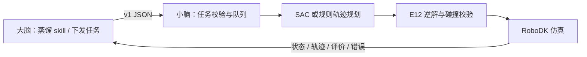

# 喷涂机器人小脑接口

大脑模块负责喷涂 skill 蒸馏、任务组织和指令下发。小脑模块负责承接结构化指令、规划喷涂轨迹、验证 E12 可执行性、运行仿真并回传状态和结果。

本仓库提供 **v1 JSON/HTTP 接口、Python 客户端、OpenAPI/JSON Schema、点云导入、SAC/规则规划、RoboDK 适配和可复现测试**。默认是联调模式；真实仿真要显式选择 `backend: robodk`。目前不包含实体机械臂通信驱动。

**接入入口：[大脑模块接入说明](docs/START_HERE.md) · [最新实验报告](docs/EXPERIMENT_20261029.md) · [新模型复现](docs/MULTISURFACE_DEMO.md)。** 软件版本为 0.3.0，HTTP/JSON 协议仍为 v1。

## 最新实验：多曲面 GPU SAC（2026-10-29）

使用已有base环境和RTX3070Ti Laptop，完成240,000步、235,000次参数更新、2,016个回合，耗时67.0分钟。网络为两层256，70维状态、2维连续动作；仅由独立验证集选择第180,000步权重。

- 训练：31种几何（7个真实扫描来源、24个合成板件），45组几何/工况配置。
- 验证：6组独立配置；真实扫描类别与训练隔离。
- 测试：4类未见真实扫描件＋6个未见合成曲面，各测试3种模拟增益。
- 当前报告展示规则蛇形、验证集固定动作、多曲面SAC三种策略，共90次对照，替代旧单样本实验结果。

| 策略 | 目标归一化RMSE ↓ | 沉积CV ↓ | 阈值覆盖率 ↑ | 目标±20%面积 ↑ |
|---|---:|---:|---:|---:|
| 规则蛇形 | 0.4849 | 0.2773 | 99.11% | 32.46% |
| 验证集固定动作 | 0.3698 | 0.2746 | 99.04% | 30.78% |
| 多曲面 SAC | 0.3702 | 0.2744 | 99.16% | 34.27% |

**完成了多曲面训练与独立测试，但SAC尚未明显优于简单固定动作。** 四类真实扫描件的新策略平均目标RMSE为0.4084，不能据此宣称强泛化或真实膜厚精度。阈值覆盖率约99%不等于喷涂合格率约99%。


权重、数据划分、90次逐项结果、热力图和E12失败样例见[实验目录](experiments/multisurface_20261029/)。原始实验共记录120次策略测试，当前展示省略其中30次旧策略对照；当前90次未重算或挑选工件。

```bash
# CPU即可复现90次测试，并核对已公布指标；不需要RoboDK或GPU
python tools/evaluate_multisurface.py --verify-recorded
```

## 精细车门演示

仓库包含Artec 3D奔驰E350实车扫描的完整精细网格、5mm派生曲面、前车门选区及多曲面GPU训练SAC权重。模型保留原始约4.88m车长、1,056,181个顶点和2,110,072个三角面。喷涂机器人为项目要求的华沿E12。


可复用已有Python3.11/3.12环境，不必另建环境。训练需可用的CUDA PyTorch；推理仅需CPU。依赖兼容已用的PyTorch2.7.1，不要求降级已有GPU环境。克隆仓库后运行：

```bash
python -m pip install -e ".[test,geometry,rl,robodk,demo]"
python tools/setup_multisurface_demo.py
python tools/fetch_robot.py
python tools/replay_demo.py --asset-id sacgen_e350_v2
# 未参与训练的合成鞍形曲面：
python tools/replay_demo.py --asset-id sacgen_saddle_v2
```

Windows安装依赖后可双击`Run_Precise_Demo.bat`或`Run_Unseen_Saddle_Demo.bat`。`Show_Demo.bat`只切回已完成的新版车门场景。通过`ROBODK_EXE`和`ROBODK_PORT`指定实际安装和端口；首次运行无需重训。详细步骤见[新版复现说明](docs/MULTISURFACE_DEMO.md)。

## 快速开始

使用 Python 3.11，在仓库根目录运行：

```bash
python -m venv .venv
# Windows PowerShell
.venv\Scripts\Activate.ps1
# Linux/macOS 改用：source .venv/bin/activate
python -m pip install -e ".[test]"
python -m spray_cerebellum
```

另开终端，激活同一环境，然后：

```bash
python examples/brain_client.py --task examples/task_mock.json
```

服务地址 `http://127.0.0.1:8765`，可交互文档 `http://127.0.0.1:8765/docs`。这个阶段不需要 RoboDK、PyTorch、GPU 或机械臂，返回的是明确标注的 mock 轨迹，验证的是大小脑消息、状态和结果对接。

**大脑只需要做：生成任务 JSON → POST `/v1/tasks` → 轮询状态 → 获取轨迹／结果。** 新任务使用新的 `task_id`；同 ID 同内容是幂等重试，不会重复执行。

接入方可参考 [接入指南](docs/HANDOFF.md)、[接口契约](docs/API_CONTRACT.md)、[输入样例](examples/task_mock.json) 和 [Python 客户端](src/spray_cerebellum/client.py)。

## 接真实 RoboDK 仿真

在装有 RoboDK 的 Windows 电脑上运行：

```bash
python -m pip install -e ".[geometry,rl,robodk,test]"
python tools/fetch_robot.py
```

先退出已经运行的服务，再设置实际安装路径并重启。PowerShell 示例：

```powershell
$env:ROBODK_EXE = 'D:\RoboDK5.9\bin\RoboDK.exe'
$env:ROBODK_PORT = '20721'
python -m spray_cerebellum
```

然后运行：

```bash
python examples/brain_client.py --task examples/task_robodk.json
```

任务会实际加载已训练 SAC、生成曲面路径、用官方 E12 模型求逆解、检查全部运动段与采样碰撞，并在 RoboDK 中仿真及逐步显示覆盖。`plan_only` 只规划并校验，`simulate` 才仿真。创建的机器人保持离线仿真模式；本接口不连接实机。

机器人文件从 RoboDK 官方模型库下载，不在仓库分发 RoboDK 程序、DLL、安装包或任何注册信息。使用者自行准备可用的 RoboDK 安装和许可。

## 输入输出边界



- 输入单位固定为 mm、mm/s，位姿使用 4×4 齐次变换；点云导入时显式声明原始单位 mm 或 m。
- 可下发枪距、名义速度、喷幅、搭接率、遍数和指定 UV 区域。未知参数会报错，气压、真实膜厚、流量等尚未建模的量不会被静默接受。
- 输出包含版本、任务状态、可执行性检查、每段 TCP 位姿/速度/开关、E12 关节角、坐标系及相对覆盖评价。
- 机器人适配目前实现华沿 E12（官方旧品牌模型 Han's E12）。协议按 `model_id` 注册机器人，其他型号会明确拒绝。
- 新点云可通过 `/v1/assets/upload` 导入，支持 PLY、ASCII/binary PCD、XYZ、数字 CSV；不支持 PCD binary_compressed。调用方必须明确指定点云到工件坐标系的变换。
- 几何后端支持已对齐的可见单值高度曲面`h(u,v)`，保留未知区域掩膜；整件分割、内腔、遮挡和多值曲面不在v1范围内。新上传点云使用`raster`；SAC只对显式绑定资产启用。新模型已做10种未见几何测试，优势有限，不能推断任意工件均可执行。
- 新模型使用`policy_observation_version: spray_v2_70`，不能与旧60维权重直接互换。新的资产注册工具绑定对应策略，外部任务字段保持v1兼容。

## 演示资产与验证

新车门资产`sacgen_e350_v2`保留原尺寸Artec扫描，人工选定约0.58m²前车门区域；新权重159段运动通过E12采样检查并完成播放。未见鞍形`sacgen_saddle_v2`完成138段播放。贝壳形第57点IK跳变、海星形第78点路径检查失败，均已拦截，不能作为成功演示。详见[运动记录](experiments/multisurface_20261029/results/robot_verification.json)。

新扫描测试件来自Real3D-AD小物体，按统一比例扩展为研究几何，不能称为实际汽车零件。所有沉积指标都基于未标定的几何高斯模型，蓝色只表示达到阈值的模拟覆盖，不是真实膜厚。旧资产ID仅用于接口兼容；当前演示入口和实验报告均使用新模型。


```bash
python -m unittest discover -s tests -v
```

核心 API 测试无需 RoboDK；几何测试安装 `geometry` extra 后执行。真实仿真的验收样例见 `docs/evidence/`。来源和适用范围见 [第三方资产说明](docs/THIRD_PARTY.md)。

## 跨电脑联调

若大脑和小脑在不同电脑，API 电脑必须能被大脑电脑访问（同一局域网或已有 VPN）。设置 `SPRAY_API_TOKEN` 后才允许监听非本地地址：

```powershell
$env:SPRAY_API_TOKEN = '<双方私下约定的随机长字符串>'
python -m spray_cerebellum --host 0.0.0.0 --port 8765
```

大脑端设置同一环境变量，并给客户端传入 `--url http://<小脑电脑的可达地址>:8765`。token 不提交 GitHub。HTTP 用于受信任内网联调，公网部署需另配 HTTPS/认证网关。
