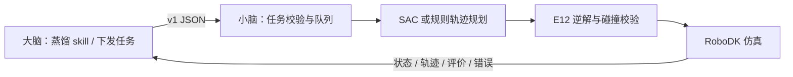
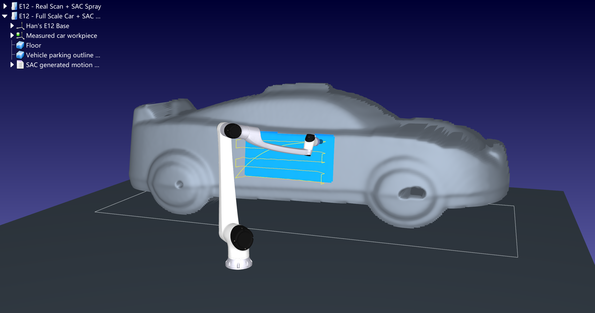

# 喷涂小脑接口：学长今天联调入口

大脑由学长负责：喷漆工喷涂 skill 的蒸馏、任务组织和指令下发。小脑由梁少天负责：承接结构化指令，规划喷涂轨迹、验证 E12 可执行性、运行仿真并回传状态和结果。

本仓库提供 **v1 JSON/HTTP 接口、Python 客户端、OpenAPI/JSON Schema、点云导入、SAC/规则规划、RoboDK 适配和可复现测试**。默认是联调模式；真实仿真要显式选择 `backend: robodk`。目前不包含实体机械臂通信驱动。

## 今天先做这三步

使用 Python 3.11，在仓库根目录运行：

```bash
python -m venv .venv
# Windows PowerShell
.venv\Scripts\Activate.ps1
# Linux/macOS 改用：source .venv/bin/activate
python -m pip install -e ".[test]"
python -m spray_cerebellum
```

另开终端，激活同一环境，然后：

```bash
python examples/brain_client.py --task examples/task_mock.json
```

服务地址 `http://127.0.0.1:8765`，可交互文档 `http://127.0.0.1:8765/docs`。这个阶段不需要 RoboDK、PyTorch、GPU 或机械臂，返回的是明确标注的 mock 轨迹，验证的是大小脑消息、状态和结果对接。

**大脑只需要做：生成任务 JSON → POST `/v1/tasks` → 轮询状态 → 获取轨迹／结果。** 新任务使用新的 `task_id`；同 ID 同内容是幂等重试，不会重复执行。

学长直接看 [今天的联调步骤](docs/HANDOFF_TODAY.md)、[接口契约](docs/API_CONTRACT.md)、[输入样例](examples/task_mock.json) 和 [Python 客户端](src/spray_cerebellum/client.py)。

## 接真实 RoboDK 仿真

在装有 RoboDK 的 Windows 电脑上运行：

```bash
python -m pip install -e ".[geometry,rl,robodk,test]"
python tools/fetch_robot.py
```

先退出已经运行的服务，再设置实际安装路径并重启。PowerShell 示例：

```powershell
$env:ROBODK_EXE = 'D:\RoboDK5.9\bin\RoboDK.exe'
$env:ROBODK_PORT = '20721'
python -m spray_cerebellum
```

然后运行：

```bash
python examples/brain_client.py --task examples/task_robodk.json
```

任务会实际加载已训练 SAC、生成曲面路径、用官方 E12 模型求逆解、检查全部运动段与采样碰撞，并在 RoboDK 中仿真及逐步显示覆盖。`plan_only` 只规划并校验，`simulate` 才仿真。创建的机器人保持离线仿真模式；本接口不连接实机。

机器人文件从 RoboDK 官方模型库下载，不在仓库分发 RoboDK 程序、DLL、安装包或任何注册信息。使用者自行准备可用的 RoboDK 安装和许可。

## 输入输出边界



- 输入单位固定为 mm、mm/s，位姿使用 4×4 齐次变换；点云导入时显式声明原始单位 mm 或 m。
- 可下发枪距、名义速度、喷幅、搭接率、遍数和指定 UV 区域。未知参数会报错，气压、真实膜厚、流量等尚未建模的量不会被静默接受。
- 输出包含版本、任务状态、可执行性检查、每段 TCP 位姿/速度/开关、E12 关节角、坐标系及相对覆盖评价。
- 机器人适配目前实现华沿 E12（官方旧品牌模型 Han's E12）。协议按 `model_id` 注册机器人，其他型号会明确拒绝。
- 新点云可通过 `/v1/assets/upload` 导入，支持 PLY、ASCII/binary PCD、XYZ、数字 CSV；不支持 PCD binary_compressed。调用方必须明确指定点云到工件坐标系的变换。
- 几何后端支持已对齐的可见单值高度曲面 `h(u,v)`，保留未知区域掩膜；不承诺任意整件分割、内腔、遮挡或多值曲面。新点云先用 `raster`；现有 SAC 只对演示资产注册，不伪装成跨零件已验证的策略。

## 演示资产与验证

演示资产来自 Real3D-AD 实物扫描小车，映射到约 4500 × 1800 × 1500 mm 的演示尺寸，固定 E12 喷涂车门附近约 1000 × 500 mm。尺寸是演示设定，并非生产整车的实测数据。SAC 已实际短训 4,000 步，推理不再训练。蓝色是未标定的几何相对覆盖，不能换算为真实微米膜厚。



```bash
python -m unittest discover -s tests -v
```

核心 API 测试无需 RoboDK；几何测试安装 `geometry` extra 后执行。真实仿真的验收样例见 `docs/evidence/`。来源和适用范围见 [第三方资产说明](docs/THIRD_PARTY.md)。

## 跨电脑联调

若大脑和小脑在不同电脑，API 电脑必须能被大脑电脑访问（同一局域网或已有 VPN）。设置 `SPRAY_API_TOKEN` 后才允许监听非本地地址：

```powershell
$env:SPRAY_API_TOKEN = '<双方私下约定的随机长字符串>'
python -m spray_cerebellum --host 0.0.0.0 --port 8765
```

大脑端设置同一环境变量，并给客户端传入 `--url http://<小脑电脑的可达地址>:8765`。token 不提交 GitHub。HTTP 用于受信任内网联调，公网部署需另配 HTTPS/认证网关。
