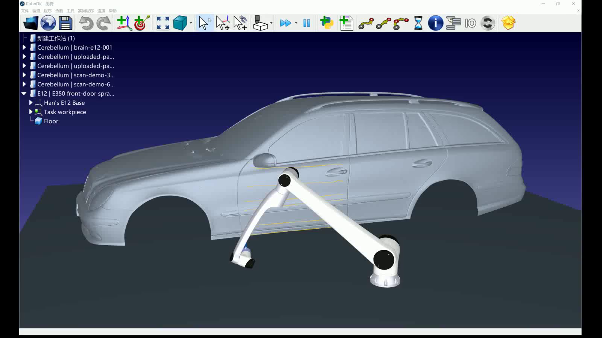
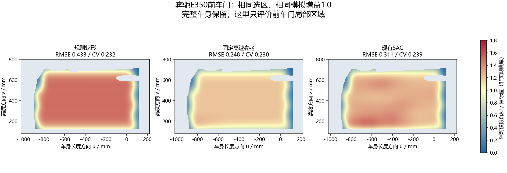

# 10.29 组会汇报

项目目标是汽车车身喷漆：大脑负责喷漆skill蒸馏和任务下达，小脑负责车身曲面轨迹、机械臂运动验证、仿真与反馈。本阶段完成车身扫描数据接入、SAC轨迹规划、E12执行验证及大小脑接口交接。

## 一、汽车喷漆演示（整车视野）

仿真场景由奔驰E350车身、华沿E12机械臂和喷枪组成。黄色线条表示TCP轨迹，蓝色区域表示模拟覆盖；喷涂选区为约0.58m²的前车门钣金面。

视频时长39.1秒，展示车身、机械臂、TCP轨迹和喷涂覆盖过程。训练与定量评价记录见实验结果。

[观看39秒汽车喷漆视频（整车视野）](media/E12_E350_WholeCar_View.mp4)

## 二、车身数据、算法与控制

车身数据来源于Artec 3D奔驰E350扫描重建网格，车长约4.88m，包含1,056,181个顶点和2,110,072个三角面。完整车身用于显示与碰撞；规划使用5mm派生曲面、25mm支持尺度平滑。车门轮廓、车窗边界和把手遮罩目前由人工指定。

小脑先生成贴合车身曲面的蛇形路线，再由Stable-Baselines3的SAC调整局部跨行位置与速度；状态为70维，包含位置、法向、工艺和7×7局部预测沉积图，动作为±10mm跨行偏移与名义速度75%～125%的修正，并限制动作突变。

机械臂为项目指定华沿E12，采用RoboDK官方Han’s E12模型，对应项目的华沿E12型号。控制为末端笛卡尔轨迹控制：生成TCP位姿、速度及喷涂开关，再由RoboDK求逆运动学；喷涂段MoveL，关枪接近段MoveJ。当前工艺为喷距200mm、名义速度400mm/s、喷幅240mm、搭接率约58.3%、一遍。

## 三、训练配置与汽车实验结果

SAC网络采用两层256单元，在本机base环境和RTX3070Ti Laptop上完成240,000步训练、235,000次参数更新、2,016个回合，耗时67.0分钟；采用验证集选中的180,000步检查点进行推理。训练采用通用曲面预训练，汽车场景以E350前车门进行回归评价，跨车型泛化尚未验证。

### 1. 对照目的与三种方法

对照检验两个问题：SAC的位置和速度调整是否优于固定路线、固定速度；效果变化是否仅靠提高速度就能实现。规则蛇形作为固定控制参照，固定高速参考用于区分单纯提速与学习策略的作用。三种方法使用同一条按曲面生成的蛇形基准路线。

| 方法 | 路线与位置 | 喷涂段速度设定 | 是否使用RL |
|---|---|---|---|
| 规则蛇形 | 固定间距往返扫描，不做策略横向偏移 | 名义速度400mm/s | 否 |
| 固定高速参考 | 使用同一基准路线，横向偏移为0 | 速度动作固定为上限，经过平滑后趋近500mm/s，即名义速度的125% | 否 |
| SAC | 在同一基准路线上按局部状态调整横向位置，范围±10mm | 策略在300～500mm/s范围内调整，并进行动作平滑 | 是 |

表中速度是指令设定值。固定高速参考从初始状态经过平滑过渡，不表示全程瞬间达到500mm/s；SAC也采用同一动作平滑和有效区边界限制。SAC在蛇形基准路线上调整动作，不是从零生成任意路径。

### 2. 共同条件与模拟系数

共同条件为：同一E350前车门约0.58m²有效选区及把手遮罩，喷距200mm、名义速度400mm/s、喷幅240mm、搭接率约58.3%、一遍；基准行距100mm，沿行采样40mm，喷枪切向倾角-10°。三种方法采用同一曲面、相对高斯沉积模型与面积统计方式。

模拟沉积增益是代码中的整体沉积倍率：相同动作下，1.0为基准，0.65将每次沉积量乘0.65，1.2乘1.2。该系数没有实测标定，不对应真实气压或出漆流量。固定轨迹和速度时，整体缩放不改变CV，只会改变绝对沉积量、目标误差及阈值覆盖；SAC可读取该系数并改变动作，因此其最终分布还可能随策略响应变化。

每种方法在0.65、1.0、1.2三个倍率下各计算一次，共3种方法×3个倍率＝9次完整数值运行。SAC使用同一个检查点，不按倍率分别重训。该设置是同一车门的已知倍率敏感性检查，不作为独立车型或未知工况泛化证据。下方结果表和热力图采用倍率1.0，不是三个倍率的平均。

### 3. 指标含义与验证范围

指标在相同有效选区内按曲面面积加权统计。代码设定的目标相对沉积量为2.2，覆盖判据为相对沉积量大于0.2；两者都是未标定的模型数值，不是微米膜厚或公司提供的工艺合格标准。

| 指标 | 具体计算含义 | 如何理解 |
|---|---|---|
| 目标RMSE | 相对沉积量与目标2.2的偏差除以2.2后，计算面积加权均方根 | 越低越接近模型目标；不是实测膜厚误差 |
| 沉积CV | 面积加权标准差除以面积加权均值 | 越低越均匀；同一分布整体乘系数时不变 |
| 阈值覆盖率 | 相对沉积量大于0.2的有效表面积占比 | 表示模型阈值下的覆盖，不等于喷涂合格率 |
| 目标±20%面积 | 相对沉积量落在1.76～2.64之间的有效表面积占比 | 越高表示更多区域落在模型目标容差内 |

CSV中的估计喷涂时间按相邻表面采样点距离／指令速度累加，不含关枪转移、路径预检和机械臂加减速，不等于录屏时长。本表来自几何沉积环境的数值计算；第4节的E12运动检查和实际播放记录对应SAC流程，并未完成三种方法的实物喷涂对照。

### 4. 对照结果（倍率1.0）

| 策略 | 目标RMSE↓ | 沉积CV↓ | 阈值覆盖率↑ | 目标±20%面积↑ |
|---|---|---|---|---|
| 规则蛇形 | 0.4329 | 0.2316 | 99.84% | 14.88% |
| 固定高速参考 | 0.2479 | 0.2301 | 99.77% | 68.02% |
| 当前SAC | 0.3113 | 0.2389 | 99.78% | 22.19% |

增益1.0时，SAC的目标误差低于规则路线，但高于固定高速参考，均匀性CV也未改善，尚未显示稳定的性能优势。蓝色覆盖和热力图基于未标定的相对沉积模型；阈值覆盖率与真实膜厚、喷涂合格率分别评价。

## 四、机械臂执行与大小脑接口

E12在RoboDK5.9.0.25042中完成159个运动点的仿真和135层覆盖显示，E12可达性、关节范围及完整采样运动／碰撞检查通过；线性路径按5mm、关节路径按1°采样，碰撞对象包含完整车身、机器人、喷枪及地面。该车门参与过预训练，只作为汽车场景回归，尚未完成独立车型测试。

接口保持统一v1 JSON／HTTP：输入车身工件ID、UV待喷区域、坐标变换、喷距／速度／喷幅／搭接率／遍数；输出任务状态、TCP位姿和速度、喷涂开关、E12关节角、运动检查及相对覆盖指标。支持取消和重复请求去重，大脑需将skill转换为结构化任务，双方端到端联调仍待实际接入。

## 五、交接与下一步

交接材料包括车身数据、SAC策略、E350实验记录、演示视频、接口文档及运行脚本。后续优先准备汽车专用训练／独立验证数据、扩展车身部位及车型，并完成大小脑联调。真实气压、雾化、流挂与膜厚尚未标定，整车全覆盖、实体机器人驱动和其他型号适配仍未完成。

[项目仓库](https://github.com/liangshaotian/robot-spray-cerebellum) · [大小脑接入](START_HERE.md) · [汽车演示复现](PRECISE_DEMO.md)
