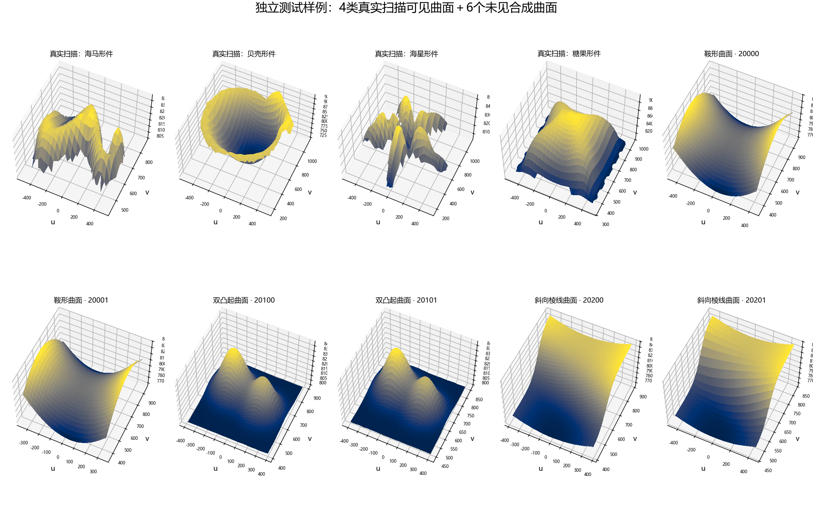
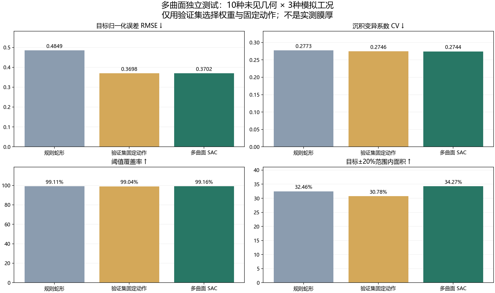
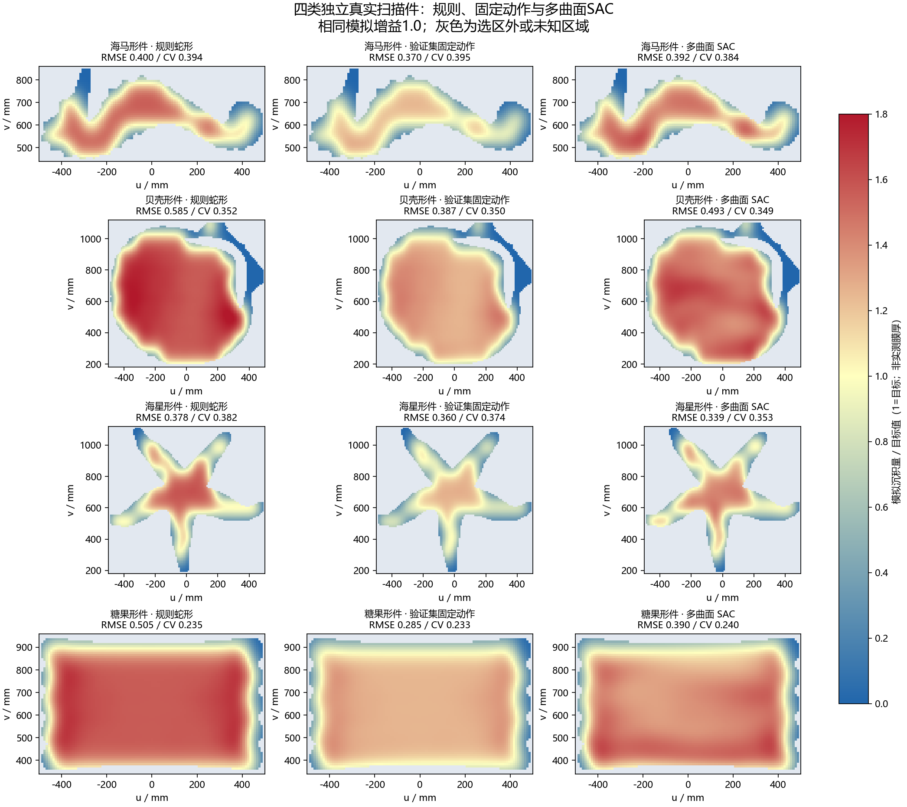
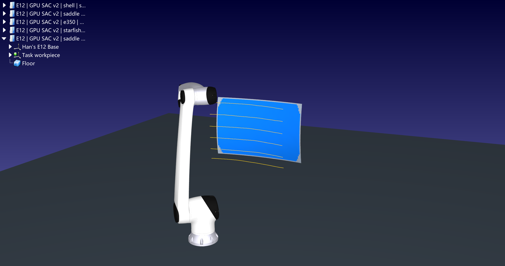

# 10.29 组会汇报

本阶段在真实扫描曲面、项目指定华沿E12和大小脑接口已跑通的基础上，完成多曲面GPU训练及独立工件测试。实验汇报更新为当前模型、数据划分、对照结果和执行边界，不再沿用单样本实验结论。

## 一、项目目标与整体流程

项目面向汽车异形曲面喷涂：大脑负责喷漆skill蒸馏和任务下达，小脑接收工件、区域及工艺指令，生成末端轨迹、验证机械臂可执行性、运行仿真并回传结果。当前目标是验证从几何输入到喷涂动作的完整流程，并检验策略在未见曲面上的表现。

流程为：真实扫描／扫描重建网格 → 选定可见曲面与有效区 → 规则蛇形基准路线 → SAC调整局部跨行位置和速度 → E12逆运动学、关节与采样碰撞检查 → RoboDK播放与相对沉积评价。控制采用末端笛卡尔轨迹：喷涂段MoveL，关枪接近段MoveJ；不是直接用RL输出六个关节控制量。

基础算法使用Stable-Baselines3的SAC；曲面环境、奖励函数、路径与接口由项目实现。状态为70维，包含位置、法向、工况、边界信息及7×7局部预测沉积图；动作为跨行偏移和速度修正，限制为±10mm、名义速度75%～125%，并平滑动作变化。

## 二、数据划分与训练规模

| 划分 | 规模 | 用途 |
|---|---|---|
| 训练 | 31种几何、45组配置 | 7个真实扫描来源＋24个合成板件；回合内随机模拟增益0.55～1.25 |
| 验证 | 6组独立配置 | 2类真实扫描＋4个合成曲面；仅此集合用于选权重与固定动作基线 |
| 独立测试 | 10种未见几何、30个工况 | 海马、贝壳、海星、糖果4类真实扫描＋6个未见合成曲面；增益0.65／1.0／1.2 |

Real3D-AD在数据增强前按完整类别划分：训练为飞机形件、糖果棒、小车、鸡形件、钻石形件、鸭形件六类；验证为鱼形件和宝石形件；测试为上述四类，彼此不重叠。训练还包含Artec E350车门。公开扫描是小型物体，经统一比例扩展用于几何迁移研究，不是实际汽车零件；E350保留约4.88m实车尺度。

E350为完整实车扫描重建网格，约106万个顶点、211万个三角面；规划提取5mm曲面、采用25mm支持尺度平滑，显示及碰撞保留原始精细网格。车门和把手遮罩仍由人工指定。新扫描仅使用明确的可见单值表面，未知区域保持掩膜。

训练直接复用本机base环境和RTX3070Ti Laptop 8GB：SAC网络两层256，批次256，经验池10万条，4个轻量环境。实际训练240,000步、235,000次参数更新、2,016个回合，耗时67.0分钟，满足两小时上限；部署权重由验证集选中，位于180,000步，而非最终步数。

## 三、独立测试与沉积结果

每种测试几何分别在3个模拟增益下比较规则蛇形、验证集选定的固定动作和多曲面SAC，共展示90次完整对照。固定动作在验证集上选定，测试集不参与模型选择。各几何等权平均，避免大工件占据统计权重。原始实验另有30次旧策略对照，本次正文省略，当前90次数据没有重训、重算或筛选工件。

| 策略 | 目标RMSE↓ | 沉积CV↓ | 阈值覆盖率↑ | 目标±20%面积↑ |
|---|---|---|---|---|
| 规则蛇形 | 0.4849 | 0.2773 | 99.11% | 32.46% |
| 验证集固定动作 | 0.3698 | 0.2746 | 99.04% | 30.78% |
| 多曲面SAC | 0.3702 | 0.2744 | 99.16% | 34.27% |

多曲面SAC相对规则路线的目标误差降低约23.7%，但固定动作的RMSE为0.3698，略优于SAC的0.3702，说明尚未证明学习策略优于简单控制。SAC的目标±20%面积为34.27%，高于固定动作的30.78%，同时估计喷涂时间为10.36s，长于固定动作的8.67s；需要同时评价误差、均匀性和效率。

仅统计4类真实扫描件，新SAC的平均目标RMSE为0.4084、CV为0.3316、阈值覆盖率为97.90%。当前结果支持“多曲面流程可运行”，不足以宣称强泛化或任意零件均匀喷涂。

热力图统一显示累计模拟沉积量／目标值：1为目标，偏低为欠沉积、偏高为过沉积；灰色为选区外或未知区域。该目标是未标定的相对量，不能换算为微米膜厚。约99%的阈值覆盖只说明达到当前几何阈值，不表示99%喷涂质量合格。

## 四、E12执行检查与接口状态

| 工件 | E12结果 | 说明 |
|---|---|---|
| E350车门 | 159个运动点完成播放 | 完整车身网格参与碰撞；该工件见于训练，仅作回归 |
| 未见合成鞍形 | 138个运动点完成播放 | 可达性及完整采样运动／碰撞检查通过 |
| 未见真实贝壳形 | 第57点预检拦截 | IK分支不连续，未执行喷涂 |
| 未见真实海星形 | 第78点预检拦截 | MoveL路径检查返回-1，未执行喷涂 |

机器人保持项目要求的华沿E12原尺寸，采用官方旧品牌Han’s E12模型；平台为RoboDK5.9.0.25042，线性路径按5mm、关节路径按1°采样检查。其余测试工件目前完成的是数值沉积评估，不能声称全部已通过机器人执行。训练未嵌入E12运动学，两个失败件保留轨迹和错误，未绕过安全检查。

大小脑继续使用统一v1 JSON／HTTP接口，输入工件ID、UV区域、坐标变换、喷距／速度／喷幅／搭接率／遍数；输出状态、TCP轨迹、喷涂开关、E12关节角、运动检查及相对覆盖指标。新资产显式绑定sac_multisurface_gpu_v2和70维观测版本；任意新上传点云不会被自动认定为已验证SAC资产，双方端到端联调仍需大脑接入。

## 五、演示与交接材料

新模型已保存权重、数据划分、训练记录、逐工件CSV、热力图及运动检查结果。仓库默认车门入口切换为新模型，并增加未见鞍形入口；无需重新训练即可复现。旧模型录屏不再作为当前实验的展示证据。

[项目仓库](https://github.com/liangshaotian/robot-spray-cerebellum) · [大小脑接入](https://github.com/liangshaotian/robot-spray-cerebellum/blob/main/docs/START_HERE.md) · [新版实验报告](https://github.com/liangshaotian/robot-spray-cerebellum/blob/main/docs/EXPERIMENT_20261029.md) · [复现与权重](https://github.com/liangshaotian/robot-spray-cerebellum/blob/main/docs/MULTISURFACE_DEMO.md)

## 六、当前结论与下一步

当前已完成多来源几何输入、多曲面GPU训练、独立测试和E12部分工件执行，尚未建立显著优于简单基线的策略。下一步应先检验奖励与动作设计的有效性、把可执行性纳入规划，并扩展真实异形件测试和大小脑联调。气压、雾化、流挂与真实膜厚未标定；固定基座整车覆盖、自动分割、实体机器人驱动及其他型号适配尚未完成。

[Real3D-AD数据来源](https://github.com/M-3LAB/Real3D-AD) · [Artec实车扫描来源](https://www.artec3d.com/3d-models/car-body) · [Stable-Baselines3 SAC](https://stable-baselines3.readthedocs.io/en/v2.4.1/modules/sac.html)
