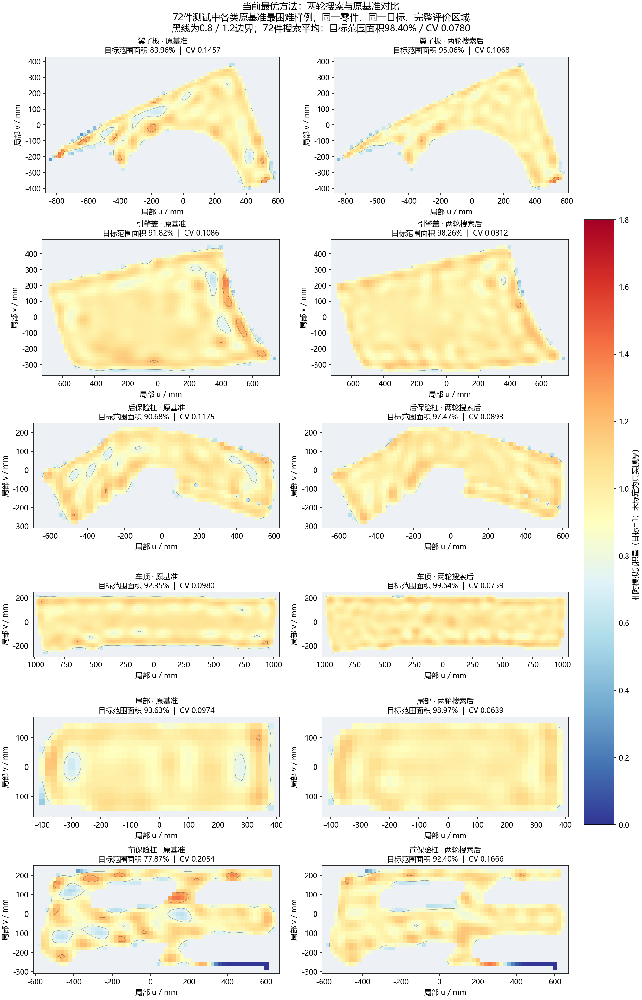
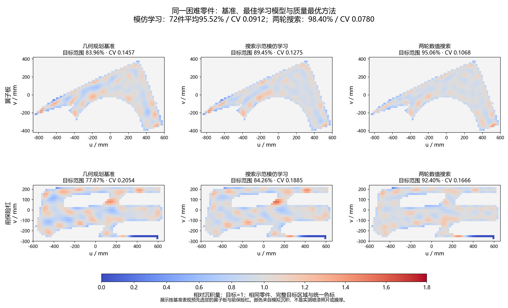

# 11.9 组会汇报

本周围绕汽车零部件喷涂，完成数据准备、学校服务器训练、几何与搜索优化，以及SAC和搜索示范模仿学习对比。实验更新至11月8日；小脑侧负责曲面轨迹、运动检查、仿真与任务反馈，演示使用项目指定华沿E12。

## 一、本周完成工作

### 1. 汽车零部件数据与训练管线

完成DrivAerNet++零件标注数据获取与转换，整理出18,953个汽车零件样本，覆盖引擎盖、车顶、翼子板、尾部、前保险杠和后保险杠六类。数据来自带零件标注的CAD衍生几何，用于构造点云和训练曲面，未包含实测喷涂膜厚或耗漆标签。

按车型设计编号隔离相关变体。原始数据池为14,752件训练、2,026件验证、2,175件测试；本轮进一步预留车型组后，全量扩权SAC使用12,388个合格训练件，固定72件验证与72件测试（各类各12件）。同一测试集已用于方案比较，不作为全新测试集。

训练和沉积计算迁移到学校服务器GPU，RoboDK保留为E12轨迹展示与运动检查平台。完善周期验证、模型与优化器保存、经验回放和随机状态恢复、异常重试、早停及训练时限控制。

### 2. 几何覆盖与确定性速度优化

先根据零件表面生成覆盖轨迹、补齐复杂边界并优化参考速度，再比较逐段数值搜索和学习策略。扩权策略输出两个表面方向的位置、扇幅朝向和速度调整；零调整复现基准，以区分几何、搜索、模仿学习和强化学习的贡献。

本周改善覆盖与均匀性的主要有效进展来自几何路径和速度优化。所有对比保持相同沉积模型及工艺设置：喷距200 mm、喷幅240 mm、搭接率约58.3%、一遍，速度限制350～450 mm/s，并限制相邻速度变化。

### 3. 强化学习诊断与实现修正

基于Stable-Baselines3 SAC开展逐点残差学习和完整零件残差诊断实验。排查并修复小幅位置偏移可能意外增加整段关喷的问题，改为整条喷涂行共同投影，保留基准开关喷拓扑；完成微小动作连续性与断点恢复检查。

完成小样本奖励／Critic诊断、12,388件全量扩权SAC训练，以及1,536件TRAIN搜索示范指导的模仿学习和SAC微调。修复搜索与原执行器连通性采样不一致的问题，全部示范重建并通过回放；各阶段模型、断点和结果分别保留。

## 二、主要方法同条件对比（更新至11.8）

同一批72件汽车零件，六类各12件，与训练车型设计组隔离；这是已使用的冻结比较集，不是全新测试集。各方法使用相同初始参考路径、评价区域和沉积模型。目标范围面积为相对沉积落在目标的80%～120%之间的面积，CV越低越均匀。

| 方法 | 目标范围面积↑ | 沉积CV↓ | 边缘目标面积↑ | 阈值覆盖率↑ | 开枪秒/件 |
| --- | --- | --- | --- | --- | --- |
| 几何规划基准 | 92.95% | 0.1056 | 88.20% | 99.944% | 17.75 |
| 同权限搜索一轮 | 97.80% | 0.0858 | 95.77% | 99.959% | 17.97 |
| 同权限搜索两轮 | 98.40% | 0.0780 | 96.90% | 99.961% | 18.05 |
| 全量扩权SAC | 95.07% | 0.0969 | 91.26% | 99.947% | 17.95 |
| 搜索示范模仿学习 | 95.52% | 0.0912 | 91.75% | 99.956% | 17.98 |
| 模仿后示范约束SAC | 95.38% | 0.0918 | 91.53% | 99.958% | 17.95 |

### 最优方法效果图

当前质量最优为两轮搜索；最佳学习模型为搜索示范模仿后的Actor。下图直接来自最终72件测试的保存结果，统一色标、目标区域和相对目标量1。

图1：当前最优两轮搜索与原基准的同件对比。六类各选当前72件测试中基准目标范围面积最低的零件，左右采用相同完整区域和色标，黑线表示0.8／1.2边界。沿用前图排版；测试样本与早期12轮搜索图不同。指标按曲面面积加权，颜色为相对模拟沉积，非实测膜厚。

图2：相同翼子板与前保险杠的几何基准、最佳学习模型及两轮搜索。区域与色标一致，可直接观察均匀度和边角变化；不是实际喷漆照片。

几何基准包含曲面覆盖与参考速度优化；搜索逐段试算位置、扇幅朝向和速度，以一轮、两轮作对照。搜索与扩权策略共享三维表面位移≤40mm、扇幅朝向±90°、速度350～450mm/s及相同平滑约束；喷距、流量与开关喷拓扑不变。最终各策略与搜索均使用修复后的同一连通性检查。

### 主要学习配置

| 方案 | 数据与初始化 | 关键配置 | 实际训练／选定候选 |
| --- | --- | --- | --- |
| 全量扩权SAC | 12,388件全部遍历；随机新网络 | 学习率3e-4，γ=1；稳健Critic与中立转移增强 | 177万环境步／67万步 |
| 搜索示范模仿学习 | 继承前项Actor；1,536件搜索示范，1,360拟合＋176内部检查 | 监督动作学习，学习率1e-4；无新增RL更新 | 2万监督更新／1万更新 |
| 模仿后示范约束SAC | 继承模仿Actor，新Critic；从完整训练池采样，实际完成2,636件 | Actor学习率1e-4，Critic 3e-4；γ=1；回报预热＋示范约束 | 22.51万环境步／2.50万步 |

三者沿用1,828维状态、CNN＋两层256单元网络，批量256；SAC回放容量20万条。模仿学习在全量SAC基础上继续训练，不是从零的纯模仿模型；其收益与后续SAC微调增量分开评价。当前选中模型为仅完成模仿学习的候选，推理不调用搜索或逐件质量拒收。

## 三、历史方案与配置诊断

下表合并同类调试配置。历史样本、参考路径或动作权限不同，不能与上表直接排名；消融和质量复核不计为重新训练的SAC成果。

| 方案 | 配置变化 | 结果与评价范围 |
| --- | --- | --- |
| 逐点受限SAC | 横向±10mm与速度调整；训练111万步 | 旧36件：71.39%，CV 0.1967。 |
| 均匀度／边缘修复SAC | 增加状态与边缘奖励、参考路径残差；训练107.6万步 | 另一批旧72件：92.43%，CV 0.1073。 |
| 固定路径速度优化 | 冻结路径，用L-BFGS-B优化速度并保留滤波 | 旧36件：77.98%，CV 0.1752；仅调速度仍不足。 |
| 覆盖与参考路径构造 | 补短喷涂行、位置／朝向优化、替代扫描轴与起始排布 | 8件开发及3件困难件诊断，用于改善几何基准。 |
| 整件四参数SAC系列 | 8→32件训练；逐步加入连续投影、CV退步惩罚、Huber价值回归 | 12件复用开发集，未稳定通过验收；扩大训练预案未启动。 |
| 局部喷涂段扩权SAC | 8件训练＋12件开发；348维状态，γ=0，自动熵系数 | 最佳已学习候选：88.18%，CV 0.1357。 |
| 扩权SAC低熵续训 | 固定熵系数0.0001，新增4,000步 | 末轮85.11%，CV 0.1451；未超过续训起点。 |
| 旧较宽权限直接搜索 | 位置／扇幅／速度粗到细优化12轮 | 另一批历史72件：98.07%，CV 0.0701；与当前搜索权限不同。 |
| 权限与冻结动作消融 | 限制位移、禁用朝向、限制速度；分别保留已学动作维度 | 12件开发：扇幅朝向影响明显；仅扩大位移不能解决学习问题。 |
| 局部价值网络修复 | 稳健MLP与结构化CNN动作排序 | 未通过门槛，仅为价值估计诊断，未形成成功SAC训练。 |
| 提议＋实际质量复核 | 策略或随机动作提议，再按沉积模型筛选 | 12件开发：策略94.10%、随机93.61%；属于混合方案，非纯SAC提升。 |

## 四、阶段结论与边界

当前质量最佳为几何规划＋逐段搜索；学习策略中，搜索示范模仿后的Actor最好。模仿学习相对原SAC目标范围面积提高约0.45个百分点，CV降低约5.9%；SAC微调未带来额外提升，且仍有个别零件退步，尚未通过全部验收门槛。

以上均为未实测标定的相对沉积指标，不代表真实膜厚或喷涂合格率。开枪时间仅为恒流耗料代理；搜索改善质量时耗料代理并未同时下降。批量数值路径回放也未替代E12实机标定、逆运动学和碰撞安全验证。

## 五、下一步工作

1. 质量优先使用几何规划＋逐段搜索，继续核对困难零件的边缘与均匀度。
2. 学习策略以搜索示范模仿后的模型为当前候选，单独评价SAC微调增量。
3. 方案确定后，再使用新的车型设计组进行泛化验收，避免反复使用测试集调参。
4. 开展E12实机标定与运动安全检查，并获取企业试喷数据标定真实膜厚和耗料。

## 记录与复现范围

[六种当前方法指标CSV](../experiments/automotive_parts_20261108/comparison.csv) · [样例指标与图片校验值](../experiments/automotive_parts_20261108/results.json)

本页同步11.9组会汇报，实验统计截至11.8；不包含前期诊断图。六类效果图沿用原来的左右对照排版，使用当前两轮搜索结果；不是早期12轮搜索的同一批样例。上方历史表中的12轮搜索与当前一／两轮搜索的样本、权限不同，不能跨表排名。

本次同步的是实验结果与图，不替换仓库原有整车演示、接口实现或演示权重。整车演示与本次多零件实验的运行范围分别按各自说明理解。

数据来源：Mohamed Elrefaie, 2025, [DrivAerNet++: Annotations](https://doi.org/10.7910/DVN/CAWRXI)，Harvard Dataverse，V1；原数据为CC BY-NC 4.0。本仓库本次仅发布研究指标及相对沉积可视化，不上传原始数据包。
