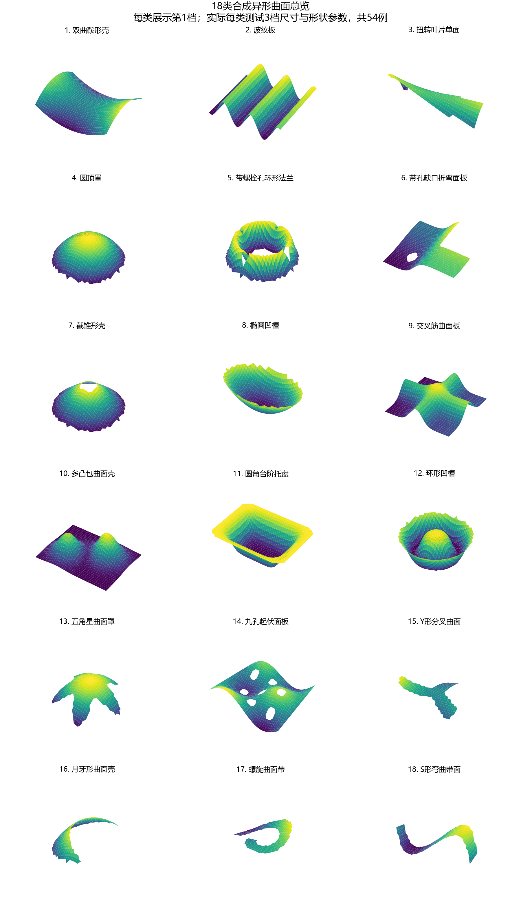
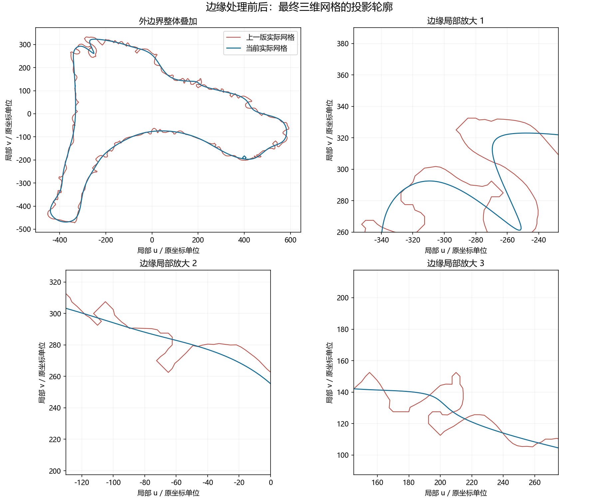
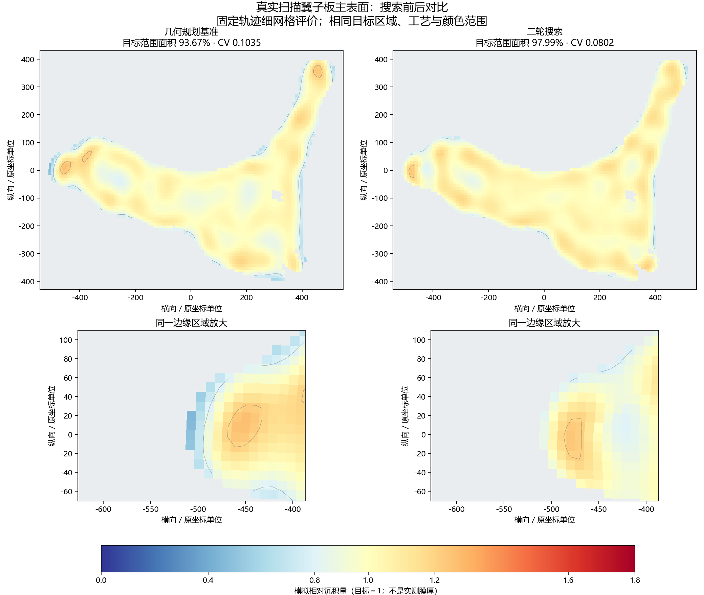
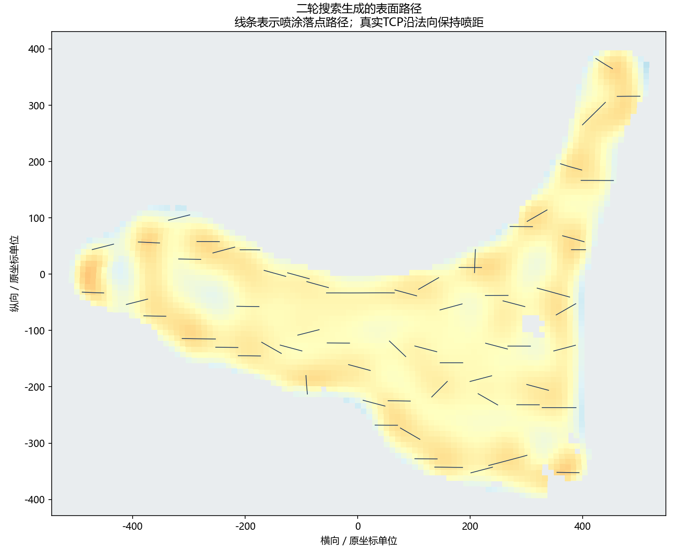

# 11.16 组会汇报

本节记录11月9日完成的工作，供11月16日组会汇报使用。重点是把已有二轮搜索方法接到真实扫描异形件上，并验证输入几何和喷涂路径。

## 一、异形件适应性与真实点云处理

补充18类、共54个合成异形曲面测试。二轮搜索在54个样例上均改善了目标范围面积和CV：平均目标范围面积93.56%→98.84%，CV 0.1018→0.0736，平均搜索用时24.7秒。这些是可控的合成单面曲面，用于检查不同形状的适应性，不能当成54个真实扫描工件。

### 补充测试的具体形状

每类测试3个参数组合，共18类54例。下表给出主要变化参数，数值按第1/2/3档顺序列出；各档的长宽尺寸也随之变化，完整54例参数已同步GitHub。高度、波高与扭转参数是曲面生成公式的系数，不等同所有位置的实际高度；扭转高度参数的单位为mm，不是角度。每行指标为该类3个样例的平均值。

|测试形状|主要几何特点与3档变化|目标范围面积（前→后）|沉积CV（前→后）|
|---|---|---:|---:|
|双曲鞍形壳|两个方向反向弯曲；曲率幅值参数：65/130/200mm|92.13% → 99.27%|0.1061 → 0.0686|
|波纹板|连续凹凸波纹；波高参数/波长：25/35/45mm；300/220/160mm|91.77% → 98.49%|0.1090 → 0.0816|
|扭转叶片单面|窄叶片扭转；扭转高度参数/拱高参数：50/100/150mm；25/35/45mm|88.99% → 98.55%|0.1174 → 0.0857|
|圆顶罩|向外鼓起的圆顶；拱高参数：60/110/170mm|94.08% → 98.01%|0.1057 → 0.0791|
|带螺栓孔环形法兰|中心大孔＋4个螺栓孔；中心孔半径/螺栓孔半径：120/190/270mm；25/35/45mm|96.80% → 99.60%|0.0879 → 0.0678|
|带孔缺口折弯面板|外边缺口、内孔与折弯并存；折弯高度参数/孔半径：60/110/170mm；45/65/85mm|92.96% → 98.85%|0.1016 → 0.0815|
|截锥形壳|带中心孔的斜面壳；斜率/中心孔半径：0.25/0.45/0.65（无量纲）；60/90/120mm|93.96% → 98.40%|0.1010 → 0.0788|
|椭圆凹槽|椭圆外形、向内凹陷；凹槽深度参数：60/100/150mm|92.52% → 97.08%|0.1120 → 0.1019|
|交叉筋曲面板|两条交叉凸筋；筋高参数/筋宽参数：45/75/100mm；90/110/120mm|97.82% → 99.83%|0.0858 → 0.0485|
|多凸包曲面壳|多个凸包和凹区相邻；起伏高度参数：60/110/160mm|98.91% → 99.91%|0.0675 → 0.0400|
|圆角台阶托盘|圆角外边和台阶过渡；台阶高度参数/过渡宽参数：40/70/100mm；50/65/80mm|97.33% → 99.95%|0.0727 → 0.0467|
|环形凹槽|圆盘上的环形凹槽；槽深参数/槽宽参数：40/65/95mm；70/90/110mm|94.89% → 99.14%|0.0952 → 0.0712|
|五角星曲面罩|五角星凹凸边界；起伏高度参数：45/80/120mm|93.79% → 99.29%|0.1019 → 0.0685|
|九孔起伏面板|九个内孔和起伏曲面；高度参数/孔半径：25/50/80mm；35/50/65mm|92.92% → 98.03%|0.1080 → 0.0899|
|Y形分叉曲面|三条分支交汇；分支宽/高度参数：130/160/190mm；40/80/120mm|91.25% → 99.36%|0.1129 → 0.0737|
|月牙形曲面壳|大凹边与窄端部；切口半径比/高度参数：0.82/0.9/0.98（无量纲）；50/85/125mm|87.99% → 96.74%|0.1329 → 0.0981|
|螺旋曲面带|弯曲螺旋窄带；带宽/高度参数：125/145/165mm；50/90/130mm|89.61% → 98.99%|0.1178 → 0.0816|
|S形弯曲带面|S形窄带和弯曲边界；高度参数：50/90/140mm|96.34% → 99.67%|0.0964 → 0.0621|

[完整54个样例的尺寸、形状参数与逐件结果](../experiments/real_scan_20261109/synthetic_cases.csv)

### 真实扫描点云如何提取并转换为算法输入

企业提供的是包含工件、支架和背景的XYZ＋RGB彩色点云，不能直接送入路径算法。本次14份PLY中11份可解析，另3份暂未解析成功；可读文件对应同一个翼子板状工件的重复扫描，包含7组不同姿态。处理顺序如下。

**原始扫描 → 工件分离 → 去噪与法向估计 → 多视角对齐、融合 → 曲面重建与缺失修补 → 边界平滑、孔洞核对 → 路径算法输入**

|处理环节|具体做法与作用|
|---|---|
|1. 读取与有效点筛选|读取XYZ坐标和RGB颜色，去掉零坐标、非有限值等无效测量。利用这批点云保留的像素排列恢复对应的颜色图和深度图，便于核对工件与背景。|
|2. 从场景中提取工件|针对本批深色工件，先从颜色较暗、深度在候选范围内的区域寻找种子；再按相邻像素的深度连续性和三维距离建立连通关系，选择面积和位置符合工件特征的区域。最后取消颜色限制，沿深度连通区域扩展，减少高光、较亮部位被漏掉的情况。|
|3. 去噪与表面方向估计|用体素采样减少密集重复点，再按邻域距离剔除离群点；通过邻近点拟合局部平面，估计每个点的表面法向。保存来源文件及原点索引，以便回查，原始扫描文件保持不变。|
|4. 多视角配准|选一份扫描作参考，用主方向估计和多个初始朝向进行粗对齐，再用ICP迭代最近点配准细化。只允许旋转和平移，不缩放、不拉伸工件；检查重叠程度、表面距离与法向是否一致。|
|5. 融合实测表面|将对齐后的观测合并；近似同一姿态的重复扫描按一组计，避免重复次数多的视角主导结果。根据不同姿态的几何支持、法向及原始颜色／深度一致性区分可靠和不确定区域，利用其他视角实际看见的表面补充单视角缺失。|
|6. 重建与缺失补偿|在局部坐标下拟合连续曲面并生成三角网格；核查表面连通性，修补有邻近实测点、曲面连续性支持的局部缺口。补偿处属于估计表面；没有观测依据的背面、遮挡区和真实大开孔，不凭空恢复。|
|7. 边界平滑与孔洞核对|将锯齿状外轮廓拟合为连续B样条曲线，并沿新轮廓重新划分边缘网格，局部平滑边带高度。结合多个原始颜色／深度视图判断真实开孔；右侧三角形孔已确认，规划前排除已确认的空缺区域，完整孔边界仍待恢复。|
|8. 转换为路径算法输入|输出局部曲面高度、法向、有效喷涂范围、开孔／非目标范围和小曲面面积，并保留坐标变换记录。路径算法据此生成覆盖轨迹并运行二轮搜索；本次仅使用正面主曲面，折回边和背面未纳入评价。|

处理量：11份扫描提取、去噪后共保留445,081个源观测点，融合为150,661个表面采样点，其中107,191个被当前一致性规则判为可靠。数量减少主要来自去背景、去噪和合并重复观测，不代表恢复了完整实物表面。最终主网格为1个面连通区域，未检测到退化面、非流形边或异常边界分叉；这些是几何检查结果，不等同人工标注分割精度或实物尺寸精度。

真实扫描工件的边界处理前后对比。外轮廓经过曲线拟合与网格重建；图示为扫描推算的曲面，不是经尺寸标定的CAD模型，孔洞及不确定区域仍按证据保留。

当前自动化程度：读取、连通分割、去噪、配准和重建已有脚本，但候选工件的语义确认、场景阈值选择、开孔判断与结果复核仍经过人工检查。这是针对本批扫描跑通的处理流程，尚不能保证任意新工件无需调整即可自动处理。原始单位、实物尺寸和机器人坐标关系也仍待确认。

## 二、真实扫描工件的二轮搜索结果

沿用已有几何规划和参考速度优化生成基准路径，再运行二轮数值搜索，逐段调整表面位置、喷幅朝向与速度。本次没有新增模型训练，也没有针对该工件调整目标量或工艺参数。测试范围为重建后的主喷涂曲面，不包含折回边和背面。

数值工况设为喷距200mm、喷幅240mm、搭接率约58.3%，速度范围350～450mm/s，单遍喷涂。原文件未声明坐标单位，本次暂按1原坐标单位＝1毫米运行，实际比例仍待确认。相对目标沉积量设为1，0.8～1.2为目标范围；CV越小表示分布越均匀。

|指标|几何规划基准|二轮搜索|
|---|---:|---:|
|目标±20%范围面积↑|93.67%|**97.99%**|
|沉积CV↓|0.1035|**0.0802**|
|边缘目标范围面积↑|90.03%|**96.73%**|
|阈值覆盖率↑|**100.00%**|**100.00%**|
|开喷时长|**10.35秒**|10.82秒|

二轮搜索用时14.8秒，生成63段喷涂路径、345个规划点。相对基准，目标范围面积提高4.32个百分点，CV降低约22.5%，边缘目标范围面积提高6.70个百分点；开喷时长增加约4.5%。恒定流量下耗料代理随开喷时长增加，暂不能换算真实漆量；表中时长不含关喷转移与加减速。

分别固定基准和搜索各自生成的三维轨迹，再用更密的采样点重算沉积指标；复核时不改变各自的轨迹、法向和开关喷。两种方法评价同一目标表面，检查未发现路径穿过已确认的孔洞或越出边界。面积指标按每块小曲面的实际面积统计。

图1：真实扫描工件主表面的搜索前后对比及同一边缘区域放大。统一色标；灰色为非目标区域，包含开孔。颜色为未标定的模拟相对沉积量，不是实测膜厚。

图2：二轮搜索生成的表面路径。线条表示表面落点路径，喷口TCP沿曲面法向保持喷距；不代表已通过E12运动验证。

## 三、当前结论与下一步

- 已跑通一个真实扫描工件的“处理后曲面→路径生成→搜索优化→数值评价”链路，主表面的均匀度和边缘指标得到改善；单件结果尚不足以证明真实扫描泛化能力。
- 继续恢复真实开孔和折边，核对原始坐标单位及工件定位，再扩展到更多独立扫描工件；不能用同一工件的不同角度代替不同测试样本。
- 尚未完成任意新工件的全自动处理流水线。需要把人工选择、开孔判断、质量检查和失败返回规则整理成统一程序。
- 本轮没有完成E12逆运动学、碰撞检查或实机喷涂。RoboDK 5.9本次出现免费授权保存条目限制提示，未完成软件内路径叠加；授权状态与启动差异待核对。数值搜索已在服务器独立完成。

## 结果与复核入口

[最终指标与范围](../experiments/real_scan_20261109/results.json) · [对比CSV](../experiments/real_scan_20261109/comparison.csv) · [数据质量记录](../experiments/real_scan_20261109/data_quality.json) · [表面与TCP轨迹CSV](../experiments/real_scan_20261109/search_path_workpiece.csv)

运行 `python tools/verify_real_scan_search.py` 可离线复核本次保存的指标、表面权重、轨迹速度范围与图片校验值，不调用RoboDK，不重训，也不等于从原始点云重新运行搜索。
