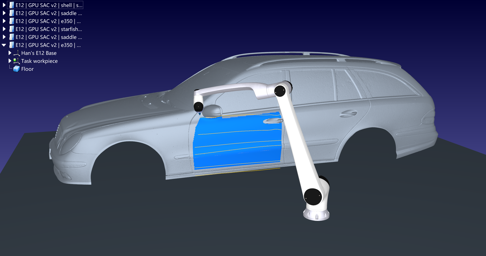

# E12精细车门演示

默认车门入口已切换为多曲面GPU训练权重。按[新版复现说明](MULTISURFACE_DEMO.md)注册`sacgen_e350_v2`，使用`Run_Precise_Demo.bat`或`examples/task_precise_door.json`运行。

车身仍是Artec 3D奔驰E350真实扫描重建网格：约4.88m车长、1,056,181个顶点、2,110,072个三角形。规划使用5mm派生曲面和25mm支持尺度平滑，显示和碰撞保留原始精细网格。车门轮廓和把手遮罩由人工指定，不是整车自动分割。

模型来自31种训练几何、45组配置；实际训练240,000步、67.0分钟，部署验证集选中的180,000步模型。数据划分、独立测试与结论统一见[10.29实验报告](EXPERIMENT_20261029.md)，本页不再保留旧单样本结果。

机器人为项目指定华沿E12，采用官方旧品牌Han's E12原尺寸模型。末端笛卡尔轨迹由RoboDK求逆解，喷涂段MoveL、关枪接近段MoveJ，按5mm/1度采样检查运动和碰撞。
