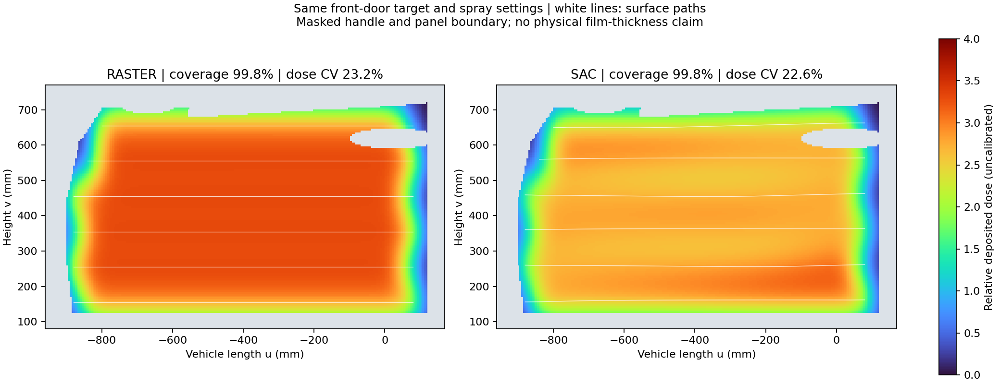

# E12 精细车门喷涂复现

## 环境与启动

验证环境为 Windows、Python 3.11、RoboDK 5.9.0.25042、官方 Han's E12 模型（项目华沿 E12 的旧品牌名称）。RoboDK 安装和许可由运行者准备，仓库不分发应用本体。

```bash
git clone https://github.com/liangshaotian/robot-spray-cerebellum.git
cd robot-spray-cerebellum
python -m venv .venv
```

Windows PowerShell 激活环境后安装依赖：

```powershell
.venv\Scripts\Activate.ps1
python -m pip install -e ".[test,geometry,rl,robodk,demo]"
python tools/setup_precise_demo.py
python tools/fetch_robot.py
$env:ROBODK_EXE = 'D:\RoboDK5.9\bin\RoboDK.exe'  # 改为实际路径
$env:ROBODK_PORT = '20721'
python tools/replay_demo.py --asset-id artec_e350_door_v2
```

若 PowerShell 不允许激活脚本，可用 `.venv\Scripts\python.exe` 替代上述 `python`，不必改变系统执行策略。安装依赖后也可双击根目录 `Run_Precise_Demo.bat`，它会优先使用 `.venv`。

`setup_precise_demo.py` 对仓库数据做 SHA256 校验，将完整精细网格解压到 `.local/assets/artec_e350_door_v2` 并注册曲面和策略。已有同版本几何与策略会复用；遇到不同数据不会静默覆盖。网格已包含在仓库中，无需访问 Artec 网站，也无需重新训练。机器人数据由官方 RoboDK CDN 获取。

脚本会复用或启动本机 HTTP 服务（8765）和 RoboDK 视图（20721）。如果运行中的服务来自另一版代码，应先在启动它的终端按 Ctrl+C，然后重新启动。运行过程包含规划和完整运动检查，随后播放动画；已验证的一次完整运行约 56 秒，实际时间随电脑性能变化。

## 界面和重播

车身、E12、黄色 TCP 轨迹及逐步出现的蓝色覆盖应同时可见。蓝色只出现在手动选定的前车门钣金区域，车窗与把手遮罩保留。半透明喷幅为显示辅助。

- `Run_Precise_Demo.bat`：新建任务，从未覆盖状态重新播放。
- `Show_Demo.bat`：切回仍在 RoboDK 中打开的已完成场景，不重复执行运动。
- 已完成场景被手动关闭或 RoboDK 重启后，使用运行入口重建场景。
- 脚本在清理旧场景后会再次显式激活新场景，避免停在空白的“新建工作站”。

## 通过大脑接口运行

```bash
python examples/brain_client.py --task examples/task_precise_door.json
```

服务需先启动。修改或再次执行样例时更换 task_id；同 ID 同参数会返回已有任务，不会重新播放。`plan_only` 做规划和运动验证，`simulate` 才执行动画。示例参数为喷距 200 mm、名义速度 400 mm/s、喷幅 240 mm、搭接率约 58.3%、一遍。

## 数据与算法

车身为 [Artec 3D 的 Car body](https://www.artec3d.com/3d-models/car-body)，原始尺度约 4.881 × 1.997 × 1.285 m，保留 1,056,181 个顶点及 2,110,072 个三角形。它是真实扫描重建网格，规划使用从网格提取的曲面数据，不能称为原始传感器点记录。来源及归档自带许可见 [第三方说明](THIRD_PARTY.md) 和 `demo/artec_e350_door_v2/LICENSE.source.txt`。

规划先按喷幅和搭接率生成蛇形路线；Stable-Baselines3 2.4.1 的 SAC 根据位置、法向及局部相对沉积情况，调整跨行位置（最多 ±10 mm）与速度（名义值的 75%–125%）。本版对动作加入因果平滑和变化率限制，规划支持曲面采用 25 mm 尺度平滑。SAC 使用自定义环境短训 4,000 步，属于流程原型。

基础算法来源为 Haarnoja 等人的 [SAC 论文](https://arxiv.org/abs/1801.01290)，代码调用 [Stable-Baselines3 SAC](https://stable-baselines3.readthedocs.io/en/v2.4.1/modules/sac.html)。喷涂环境、奖励函数、蛇形基准路径和集成流程为本项目编写，没有复现某篇喷涂论文的完整实验。

E12 保持原尺寸，喷距沿喷射轴计算；精细演示配置固定 -10° 切向倾角以避开腕部奇异位置，真实表面法向与喷射轴分别记录。原始精细网格用于碰撞检查；5 mm 网格用于规划与覆盖，不替换显示模型。

## 结果评价与重训



规则路线与 SAC 在相同选区和工艺设置下，几何阈值覆盖率均约 99.8%；相对沉积 CV 分别约 23.2% 和 22.6%。这是单个工件、一次短训策略的简化模型结果，不构成生产喷涂质量或统计显著性证明。几何覆盖、相对沉积、可达性和碰撞结果应分别判断。

以下步骤为可选研究工具，查看演示不需要执行：

```bash
python tools/plot_door_coverage.py
# 从保留的原始精细网格重新生成曲面与遮罩，随后重训/注册策略：
python tools/prepare_door_demo.py
python tools/train_registered_policy.py .local/assets/artec_e350_door_v2 --policy-id sac_e350_door_v2 --timesteps 4000
```

重建曲面会清除该本地资产的策略注册，重训完成后恢复。图表默认输出至 `.local/precise_demo_report/`。手动调整规划区、曲面处理或过程参数后，应重新评估匹配策略。自动车门分割、完整整车覆盖、真实膜厚、气压/雾化、实体机械臂驱动和跨型号验证均未包含在该演示中。
