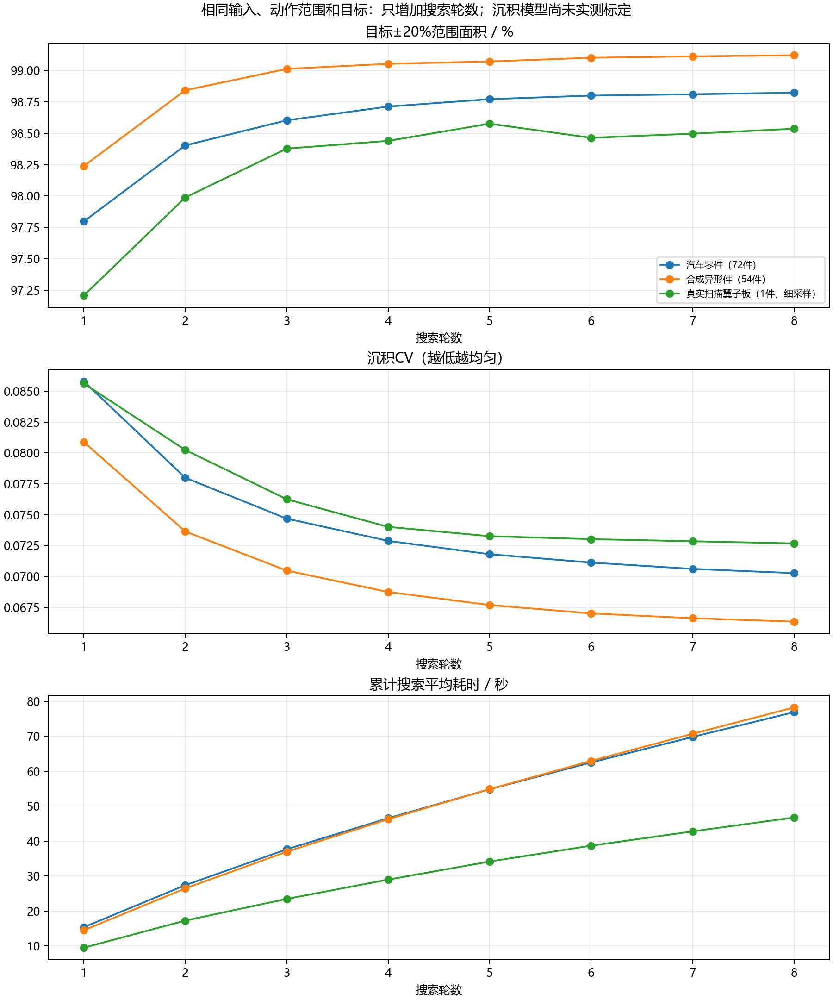
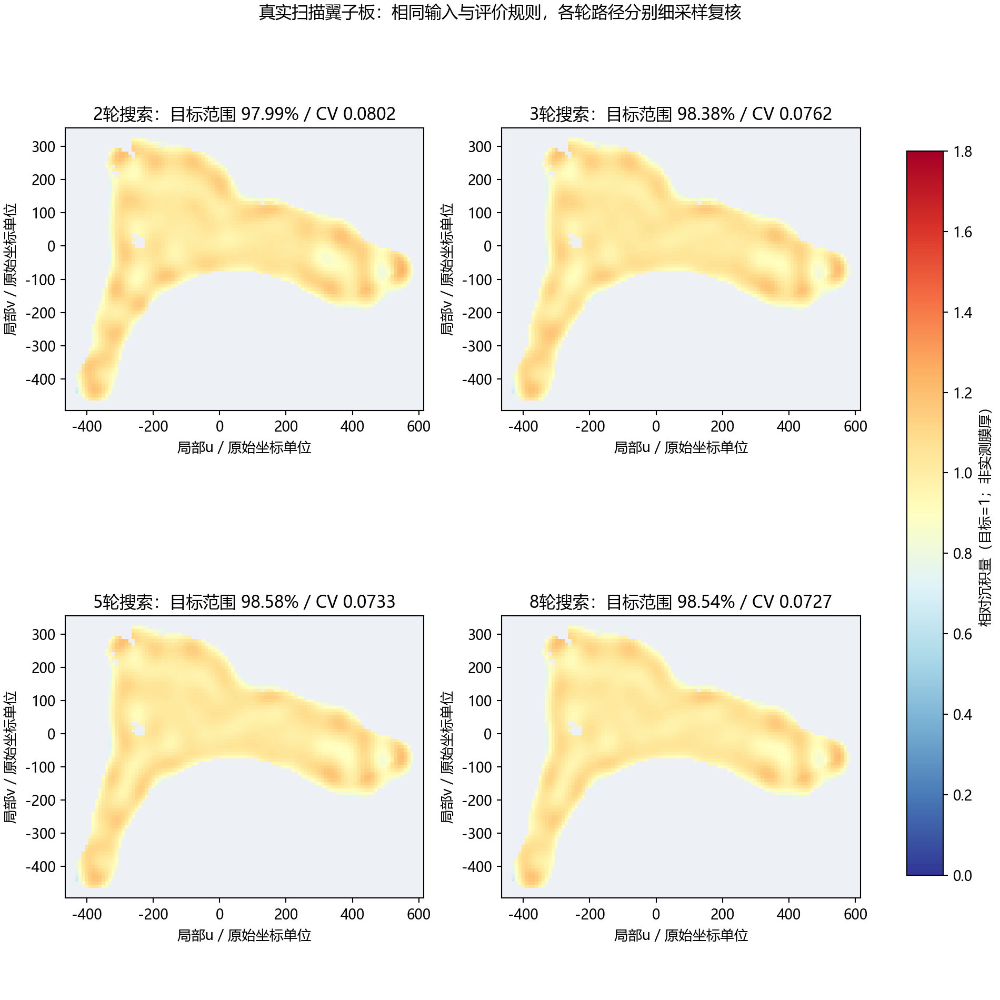

# 搜索轮数对比（2026-11-10）

## 结论

增加到3—4轮值得考虑：相对2轮，目标范围面积和均匀度均有实际改善。4轮适合作为计算时间与质量的折中；8轮在本次汽车样例平均指标上更好，适合允许更长规划时间、优先追求均匀度的场合。
汽车零件上，4轮获得2→8轮约73.6%的目标范围面积提升，耗时约为8轮的60.6%。8轮相对2轮，沉积CV降低9.9%。这不是所有零件的最优轮数，也没有证明继续增加轮数不再有收益。
原有二轮搜索演示和已发布结果未被替换。

仅增加搜索轮数，其余输入、动作范围、评价目标和约束不变。各轮结果均重新通过原执行器回放。汽车72件为此前使用过的测试样例，未新增独立测试集；不涉及训练。
整组结果为逐件平均；每件零件内部的面积比例与CV按曲面面积计算。搜索用时为本次同机测量，不能直接与不同负载下的历史耗时混比。

## 汽车零件：72件

|轮数|目标±20%面积|沉积CV↓|边缘目标面积|覆盖率|搜索均时|比2轮增加|目标面积下降样例数|
|---|---|---|---|---|---|---|---|
|2|98.403%|0.07799|96.902%|99.9606%|27.39秒|+0.000个百分点|0/72|
|3|98.603%|0.07468|97.290%|99.9606%|37.66秒|+0.200个百分点|2/72|
|4|98.712%|0.07287|97.484%|99.9606%|46.55秒|+0.309个百分点|1/72|
|5|98.771%|0.07179|97.589%|99.9606%|54.83秒|+0.368个百分点|0/72|
|6|98.799%|0.07112|97.645%|99.9606%|62.48秒|+0.397个百分点|0/72|
|8|98.823%|0.07026|97.684%|99.9606%|76.86秒|+0.420个百分点|1/72|

## 合成异形件：54件

|轮数|目标±20%面积|沉积CV↓|边缘目标面积|覆盖率|搜索均时|比2轮增加|目标面积下降样例数|
|---|---|---|---|---|---|---|---|
|2|98.842%|0.07364|97.420%|100.0000%|26.47秒|+0.000个百分点|0/54|
|3|99.012%|0.07047|97.787%|100.0000%|36.96秒|+0.170个百分点|1/54|
|4|99.053%|0.06873|97.900%|100.0000%|46.26秒|+0.211个百分点|0/54|
|5|99.071%|0.06768|97.936%|100.0000%|54.87秒|+0.229个百分点|0/54|
|6|99.101%|0.06700|97.981%|100.0000%|62.92秒|+0.259个百分点|1/54|
|8|99.120%|0.06633|98.025%|100.0000%|78.21秒|+0.278个百分点|1/54|

## 真实扫描翼子板：1件，采用细采样复核

|轮数|目标±20%面积|沉积CV↓|边缘目标面积|覆盖率|搜索均时|比2轮增加|目标面积下降样例数|
|---|---|---|---|---|---|---|---|
|2|97.988%|0.08024|96.729%|100.0000%|17.27秒|+0.000个百分点|0/1|
|3|98.377%|0.07625|97.362%|100.0000%|23.48秒|+0.389个百分点|0/1|
|4|98.439%|0.07401|97.461%|100.0000%|28.99秒|+0.451个百分点|0/1|
|5|98.576%|0.07325|97.684%|100.0000%|34.16秒|+0.587个百分点|0/1|
|6|98.463%|0.07301|97.501%|100.0000%|38.69秒|+0.475个百分点|0/1|
|8|98.536%|0.07267|97.619%|100.0000%|46.74秒|+0.547个百分点|0/1|

## 评价边界

搜索耗时不含共同输入准备、结果回放和绘图；12个样例并行，每个样例仅用1个CPU线程，未使用GPU。真实扫描件以固定源轨迹细采样结果为主，其他样例沿用原评价网格。
质量目标函数下降不等于每个单项指标都改善，表中保留下降样例。相对沉积模型未经过实测标定；新增三轮及以上轨迹尚未完成E12逆运动学和碰撞验证。

